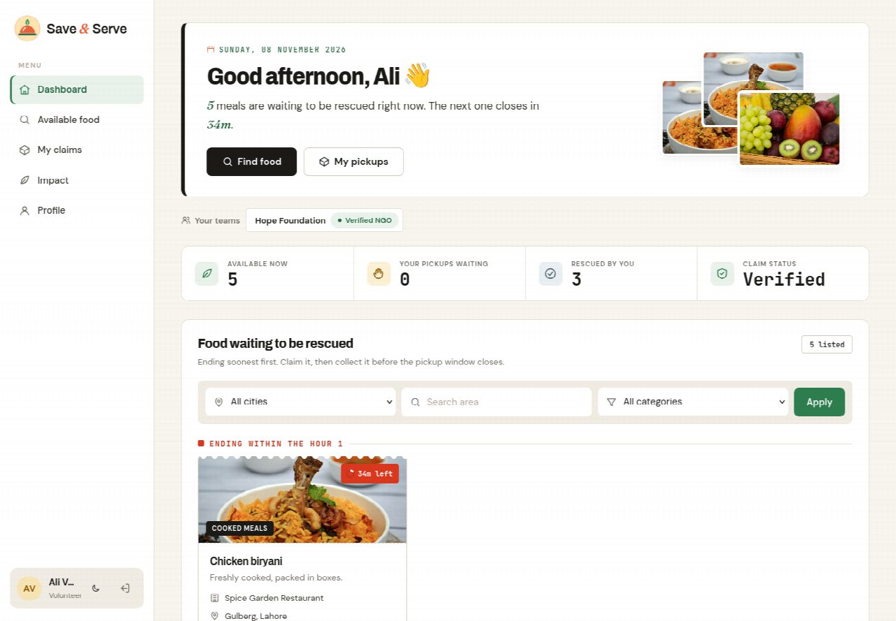

# FoodShare – Surplus Food Sharing Platform

Restaurants and wedding halls throw away edible food while people nearby go hungry.
**FoodShare** lets donors post surplus food with a quantity and pickup window, and lets NGOs and
verified volunteers claim and collect it before it goes to waste.

**Stack:** PHP 8 (PDO, sessions), MySQL / MariaDB, HTML, CSS and vanilla JavaScript. No framework.
See [PRD.md](PRD.md) for requirements and [docs/erd.mmd](docs/erd.mmd) for the database design.



## Features

### Donor
- Post surplus food: title, category, quantity, description, pickup window and pickup address.
- Dashboard of all their posts with status, time left and who claimed each one.
- **Edit** or **withdraw** a post while nobody has claimed it. Extending the pickup time revives an expired post.
- See the claimer's name, NGO and phone, then **mark the food collected** at pickup.

### NGO / volunteer
- Browse available food as cards, soonest-ending first, with **filters** by city, area and category.
- **Claim** food (one claim per post) and **cancel** a claim if plans change.
- After claiming, see the donor's **full pickup address and phone number**.
- NGO managers have a **My team** page: add volunteers by email and remove them.
  Members of a verified NGO can claim on its behalf.

### Admin
- **Verify** or **reject** NGO registrations and volunteer accounts.
- Overview of pending requests, registered users and completed pickups.

### Everyone
- **Post detail page** with a **history timeline**: who posted, claimed, cancelled or collected, and when.
- **Profile page** to edit name, phone and address, and to change the password.
- Responsive layout that works on phones.

## How a post moves

```
               claim                    donor confirms pickup
 available ───────────────► claimed ───────────────────────► collected
   │  ▲                        │
   │  └──── claimer cancels ───┘
   │
   ├── donor withdraws ───────► withdrawn
   └── pickup time passes ────► shown as "expired" (calculated, not stored)
```

Every status change is stored in `post_status_logs` together with who made it, and shown on the post's timeline.

## Who can claim
A user can claim food if **either**:
1. they are a member of a **verified NGO** (`ngo_members` + `ngos.is_verified`); the claim is recorded for that NGO in `claims.ngo_id`, **or**
2. they are a **volunteer verified by the admin** (`users.is_verified`).

## Security
| Concern | How it is handled |
|---|---|
| Passwords | `password_hash()` / `password_verify()`; minimum 8 characters |
| SQL injection | Every query uses PDO prepared statements |
| XSS | All output passes through `htmlspecialchars` via `e()` |
| CSRF | Every state-changing action is POST-only and checks a per-session token (`require_post()`) |
| Session fixation | `session_regenerate_id()` on login and on password change |
| Double claiming | `SELECT … FOR UPDATE` row lock inside a transaction, plus `UNIQUE (claims.post_id)` |
| Access control | `require_role()` on every page; contact details only shown to the two parties of a claim |

## Setup

1. **Create the database and demo data**
   ```bash
   mysql -u root -p < sql/schema.sql
   mysql -u root -p < sql/seed.sql
   ```
2. **Create a MySQL user for the app** (on Ubuntu, `root` usually only works through `sudo`)
   ```sql
   CREATE USER 'food_app'@'localhost' IDENTIFIED BY 'choose_a_password';
   GRANT ALL PRIVILEGES ON food_share.* TO 'food_app'@'localhost';
   ```
3. **Configure the connection**
   ```bash
   cp config/db.example.php config/db.php   # then put your MySQL user and password in it
   ```
   `config/db.php` is git-ignored, so your password never reaches GitHub.
4. **Run it**
   ```bash
   php -S localhost:8000
   ```
   and open http://localhost:8000, or serve the folder with Apache.

> **Demo times are relative.** The seed data sets pickup windows from the moment it is loaded, so after a few
> hours most posts show as expired. Re-run both SQL files before a demo to make them fresh again.

### Upgrading a database created before November 2026
Two columns were added after the original schema. Run once:
```sql
ALTER TABLE food_posts MODIFY status ENUM('available','claimed','collected','withdrawn') NOT NULL DEFAULT 'available';
ALTER TABLE users ADD COLUMN rejected_at DATETIME NULL AFTER is_verified;
ALTER TABLE ngos  ADD COLUMN rejected_at DATETIME NULL AFTER is_verified;
```

## Demo accounts
All use the password **`password123`**.

| Role | Email | Notes |
|---|---|---|
| Admin | admin@foodshare.test | Verifies and rejects NGOs and volunteers |
| Donor | donor@foodshare.test | Spice Garden Restaurant, has 7 posts |
| NGO | ngo@foodshare.test | Manager of Hope Foundation (verified) |
| Volunteer | volunteer@foodshare.test | Verified, and a member of Hope Foundation |

## Screenshots

| Login | Donor dashboard |
|---|---|
|  |  |
| **Post detail and history** | **NGO team** |
|  |  |
| **Admin** | |
|  | |

## Project structure
```
index.php         redirects to login or dashboard
signup.php        sign up as donor, NGO or volunteer
login.php         log in        logout.php   log out (POST + CSRF)
home.php          role-based dashboard
post_food.php     create a post, or edit one with ?id=N
post.php          post details and status history timeline
claim.php         claim a post          cancel.php    cancel a claim
collect.php       donor confirms pickup withdraw.php  donor withdraws a post
verify.php        admin verifies or rejects NGOs and volunteers
team.php          NGO manager adds and removes volunteer members
profile.php       edit contact details and change password

config/           db.example.php (copy to db.php)
includes/         auth.php (sessions, roles, CSRF, claim rules), ui.php (icons, helpers),
                  header.php, footer.php, auth_hero.php
sql/              schema.sql, seed.sql
docs/             erd.mmd, project documentation (.docx), screenshots/
assets/           css/style.css, js/validate.js, img/ (category and login photos)
```

## Database
Eight tables, see [docs/erd.mmd](docs/erd.mmd):
`users`, `locations`, `ngos`, `ngo_members` (many-to-many between users and NGOs),
`food_categories`, `food_posts`, `claims` (one per post) and `post_status_logs` (history).

## Image credits
Photos in `assets/img/` are from [Unsplash](https://unsplash.com) and used under the
[Unsplash License](https://unsplash.com/license) (free for commercial and non-commercial use).

| File | Source |
|---|---|
| hero-sharing.jpg | https://images.unsplash.com/photo-1576867757603-05b134ebc379 |
| cat-cooked.jpg | https://images.unsplash.com/photo-1631515243349-e0cb75fb8d3a |
| cat-bakery.jpg | https://images.unsplash.com/photo-1549931319-a545dcf3bc73 |
| cat-fresh.jpg | https://images.unsplash.com/photo-1619566636858-adf3ef46400b |
| cat-packaged.jpg | https://images.unsplash.com/photo-1584473457406-6240486418e9 |
| cat-event.jpg | https://images.unsplash.com/photo-1555244162-803834f70033 |
| cat-default.jpg | https://images.unsplash.com/photo-1565557623262-b51c2513a641 |
