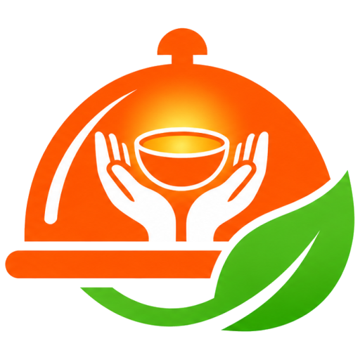
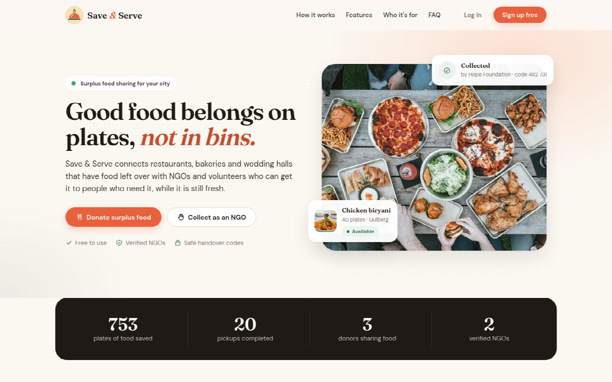
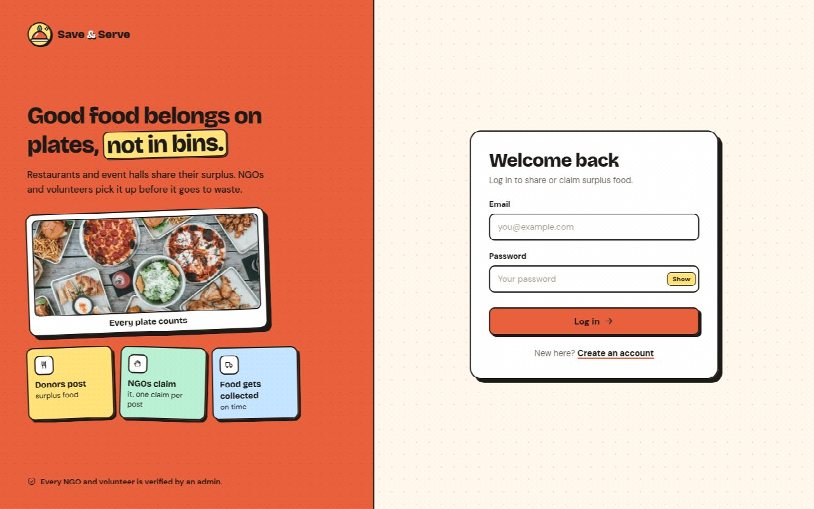
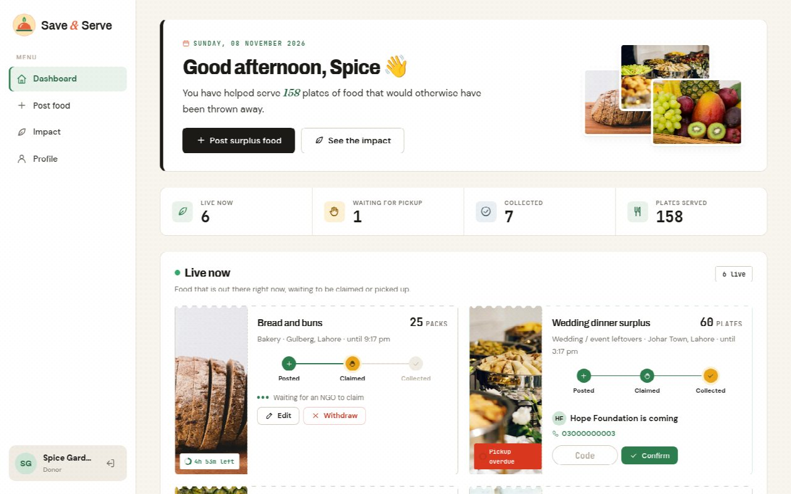
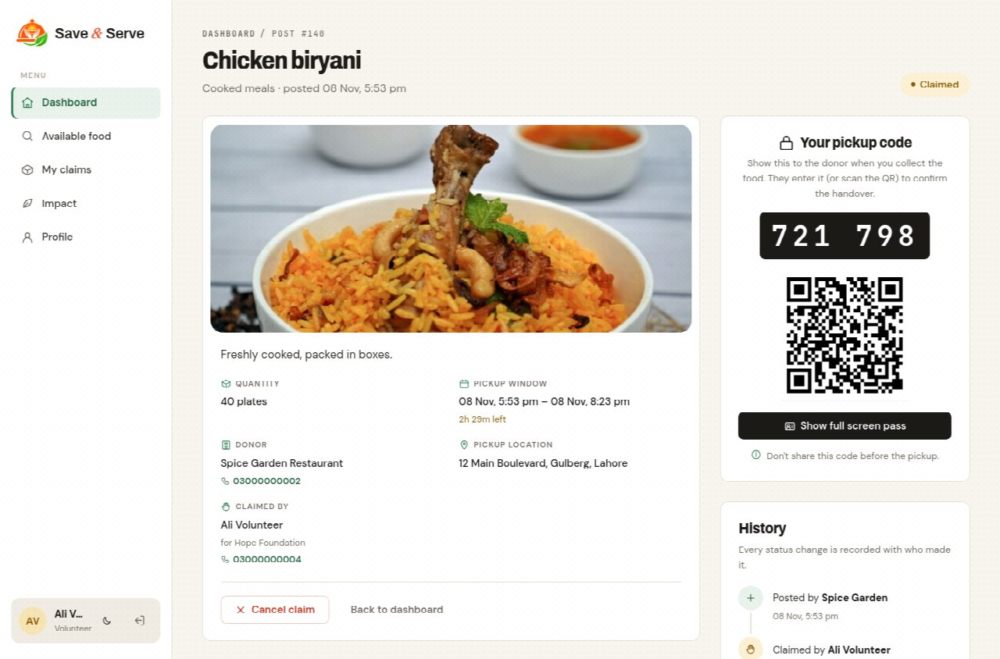
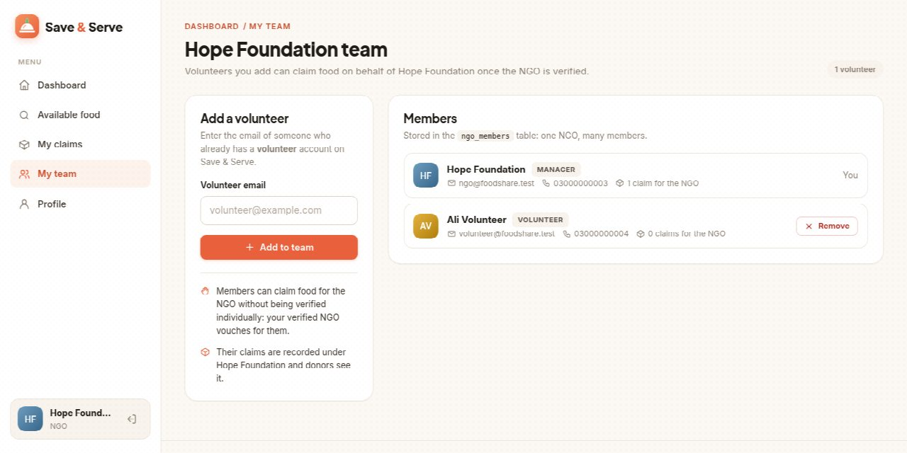
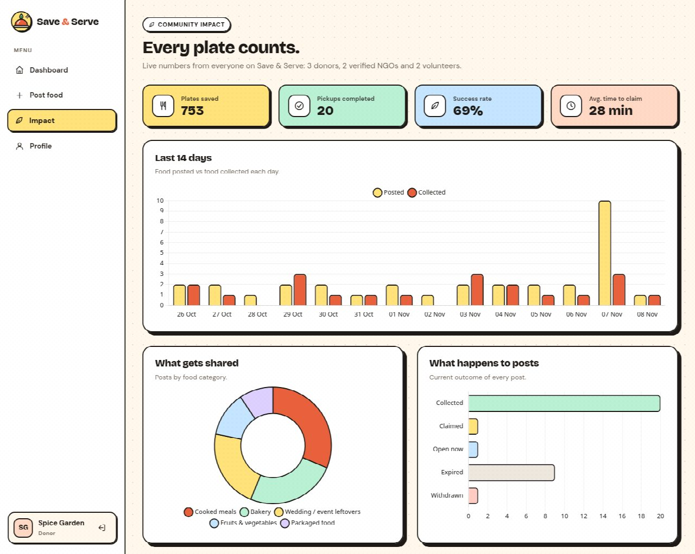
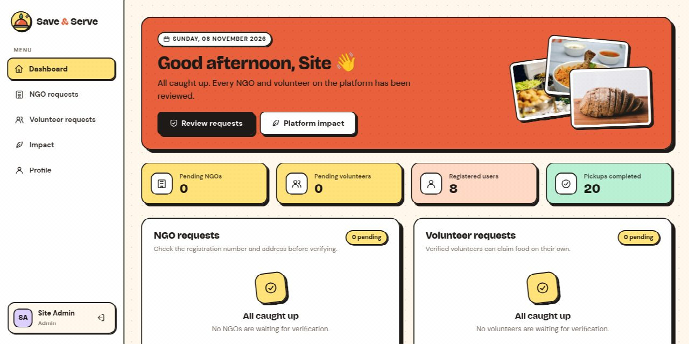
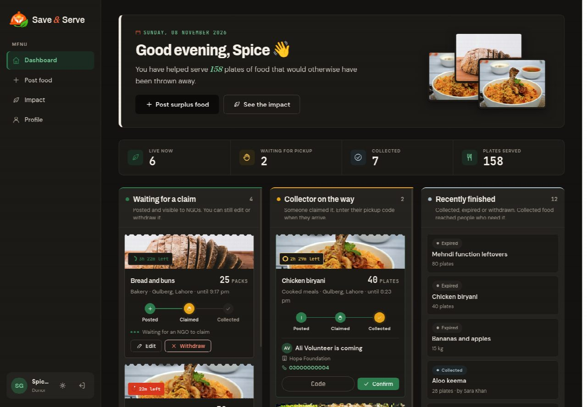

# Save & Serve – Surplus Food Sharing Platform

Restaurants and wedding halls throw away edible food while people nearby go hungry.
**Save & Serve** lets donors post surplus food with a quantity and pickup window, and lets NGOs and
verified volunteers claim and collect it before it goes to waste.

**Stack:** PHP 8 (PDO, sessions), MySQL / MariaDB, HTML, CSS and vanilla JavaScript. No framework.
See [PRD.md](PRD.md) for requirements and [docs/erd.mmd](docs/erd.mmd) for the database design.



## Features

### Public homepage
- A full landing page for visitors: navbar with Log in / Sign up, introduction, live impact numbers, how it works,
  features, who it's for (with role-specific sign-up links), a live preview of open food, FAQ and footer.

### Donor
- Post surplus food: title, category, quantity, description, pickup window and pickup address.
- Dashboard as three lanes: **Now** (waiting for a claim), **Next** (collector on the way) and **Done**.
- **Post again** from any previous post, and quick pickup-window chips (next 2h, 4h, until midnight).
- **Edit** or **withdraw** a post while nobody has claimed it. Extending the pickup time revives an expired post.
- See the claimer's name, NGO and phone, then confirm the pickup by entering the collector's **pickup code** (or scanning their QR code).

### NGO / volunteer
- Browse available food as cards, soonest-ending first, with **filters** by city, area and category.
- Open food is grouped by urgency (ending within the hour, later today, tomorrow).
- **Claim** food after a confirmation sheet ("Can you get there by 5:17 pm?") and **cancel** a claim if plans change.
- A full-screen **pickup pass** (code, QR, address) to show the donor at handover.
- After claiming, see the donor's **full pickup address and phone number**, plus a **6-digit pickup code and QR code** to show at handover.
- NGO managers have a **My team** page: add volunteers by email and remove them.
  Members of a verified NGO can claim on its behalf.

### Admin
- **Verify** or **reject** NGO registrations and volunteer accounts.
- Overview of pending requests, registered users and completed pickups.

### Everyone
- **Light and dark mode** (follows the device, with a toggle), keyboard-friendly focus styles and a skip link.
- **Mobile bottom tab bar** on phones, with a raised button for each role's main action.
- **Post detail page** with a **history timeline**: who posted, claimed, cancelled or collected, and when.
- **Impact dashboard** with charts: plates saved, success rate, average time to claim, a 14-day activity chart, posts by category, outcomes, and top donors and collectors.
- **Profile page** to edit name, phone and address, and to change the password.
- Responsive layout that works on phones.

## How a post moves

```
               claim                donor enters the pickup code
 available ───────────────► claimed ───────────────────────► collected
   │  ▲                        │
   │  └──── claimer cancels ───┘
   │
   ├── donor withdraws ───────► withdrawn
   └── pickup time passes ────► shown as "expired" (calculated, not stored)
```

Every status change is stored in `post_status_logs` together with who made it, and shown on the post's timeline.

## Pickup codes
Each claim has a 6-digit code, calculated as an HMAC of the claim (id, post, claimer, time) with a secret key
(`APP_SECRET`). Nothing extra is stored in the database, a cancelled-and-reclaimed post gets a new code, and
without the secret nobody can work a code out. The claimer shows the code (or its QR code) at pickup and the
donor enters it to mark the food collected. Five wrong codes lock that post for ten minutes.

## Who can claim
A user can claim food if **either**:
1. they are a member of a **verified NGO** (`ngo_members` + `ngos.is_verified`); the claim is recorded for that NGO in `claims.ngo_id`, **or**
2. they are a **volunteer verified by the admin** (`users.is_verified`).

## Security
| Concern | How it is handled |
|---|---|
| Passwords | `password_hash()` / `password_verify()`; minimum 8 characters |
| SQL injection | Every query uses PDO prepared statements |
| XSS | All output passes through `htmlspecialchars` via `e()` |
| CSRF | Every state-changing action is POST-only and checks a per-session token (`require_post()`) |
| Session fixation | `session_regenerate_id()` on login and on password change |
| Double claiming | `SELECT … FOR UPDATE` row lock inside a transaction, plus `UNIQUE (claims.post_id)` |
| Access control | `require_role()` on every page; contact details only shown to the two parties of a claim |
| Wrong person collecting | Collection needs the claimer's HMAC pickup code; 5 wrong tries lock the post for 10 minutes |

## Setup

1. **Create the database and demo data**
   ```bash
   mysql -u root -p < sql/schema.sql
   mysql -u root -p < sql/seed.sql
   ```
2. **Create a MySQL user for the app** (on Ubuntu, `root` usually only works through `sudo`)
   ```sql
   CREATE USER 'food_app'@'localhost' IDENTIFIED BY 'choose_a_password';
   GRANT ALL PRIVILEGES ON food_share.* TO 'food_app'@'localhost';
   ```
3. **Configure the connection**
   ```bash
   cp config/db.example.php config/db.php   # then put your MySQL user and password in it
   ```
   Also set `APP_SECRET` in it to a long random string (used for pickup codes), e.g. the output of
   `php -r "echo bin2hex(random_bytes(32));"`. `config/db.php` is git-ignored, so your secrets never reach GitHub.
4. **Run it**
   ```bash
   php -S localhost:8000
   ```
   and open http://localhost:8000, or serve the folder with Apache.

> **Demo times are relative.** The seed data sets pickup windows from the moment it is loaded, so after a few
> hours most posts show as expired. Re-run both SQL files before a demo to make them fresh again.

### Upgrading a database created before November 2026
Two columns were added after the original schema. Run once:
```sql
ALTER TABLE food_posts MODIFY status ENUM('available','claimed','collected','withdrawn') NOT NULL DEFAULT 'available';
ALTER TABLE users ADD COLUMN rejected_at DATETIME NULL AFTER is_verified;
ALTER TABLE ngos  ADD COLUMN rejected_at DATETIME NULL AFTER is_verified;
```
and add an `APP_SECRET` line to `config/db.php` (see `config/db.example.php`).

## Demo accounts
All use the password **`password123`**.

| Role | Email | Notes |
|---|---|---|
| Admin | admin@saveandserve.test | Verifies and rejects NGOs and volunteers |
| Donor | donor@saveandserve.test | Spice Garden Restaurant |
| Donor | marquee@saveandserve.test | Royal Palm Marquee (wedding hall) |
| Donor | bakery@saveandserve.test | Daily Bread Bakery |
| NGO | ngo@saveandserve.test | Manager of Hope Foundation (verified) |
| NGO | rizq@saveandserve.test | Manager of Rizq Welfare (verified) |
| Volunteer | volunteer@saveandserve.test | Verified, and a member of Hope Foundation |
| Volunteer | sara@saveandserve.test | Verified, independent |

The seed also contains two weeks of past activity so the Impact charts have data.

## Screenshots

| Login | Donor dashboard |
|---|---|
|  |  |
| **Pickup code and history** | **NGO team** |
|  |  |
| **Impact dashboard** | **Admin** |
|  |  |
| **Dark mode** | |
|  | |

## Project structure
```
index.php         public homepage (logged-in users go to their dashboard)
signup.php        sign up as donor, NGO or volunteer
login.php         log in        logout.php   log out (POST + CSRF)
home.php          role-based dashboard
post_food.php     create a post, or edit one with ?id=N
post.php          post details, status history timeline, pickup code + QR
impact.php        community impact dashboard with charts
claim.php         claim a post          cancel.php    cancel a claim
collect.php       donor confirms pickup with the code   withdraw.php  donor withdraws a post
verify.php        admin verifies or rejects NGOs and volunteers
team.php          NGO manager adds and removes volunteer members
profile.php       edit contact details and change password

config/           db.example.php (copy to db.php)
includes/         auth.php (sessions, roles, CSRF, claim rules), ui.php (icons, helpers),
                  header.php, footer.php, auth_hero.php
sql/              schema.sql, seed.sql
docs/             erd.mmd, project documentation (.docx), screenshots/
assets/           css/style.css, js/ (validate.js, impact.js, pickup.js, vendor/), img/ (logo and photos)
```

## Database
Eight tables, see [docs/erd.mmd](docs/erd.mmd):
`users`, `locations`, `ngos`, `ngo_members` (many-to-many between users and NGOs),
`food_categories`, `food_posts`, `claims` (one per post) and `post_status_logs` (history).

## Third-party libraries
Bundled in `assets/js/vendor/` so everything works offline:
- [Chart.js](https://www.chartjs.org) 4.4.1, MIT License
- [qrcode-generator](https://github.com/kazuhikoarase/qrcode-generator) 1.4.4 by Kazuhiko Arase, MIT License

Fonts: Archivo, DM Sans, JetBrains Mono and Fraunces from Google Fonts (SIL Open Font License).

## Image credits
The logo (`logo.png`, with `logo-192.png` and `favicon.png` sizes) is the project's own artwork. Photos in `assets/img/` are from [Unsplash](https://unsplash.com) and used under the
[Unsplash License](https://unsplash.com/license) (free for commercial and non-commercial use).

| File | Source |
|---|---|
| hero-sharing.jpg | https://images.unsplash.com/photo-1576867757603-05b134ebc379 |
| cat-cooked.jpg | https://images.unsplash.com/photo-1631515243349-e0cb75fb8d3a |
| cat-bakery.jpg | https://images.unsplash.com/photo-1549931319-a545dcf3bc73 |
| cat-fresh.jpg | https://images.unsplash.com/photo-1619566636858-adf3ef46400b |
| cat-packaged.jpg | https://images.unsplash.com/photo-1584473457406-6240486418e9 |
| cat-event.jpg | https://images.unsplash.com/photo-1555244162-803834f70033 |
| cat-default.jpg | https://images.unsplash.com/photo-1565557623262-b51c2513a641 |
